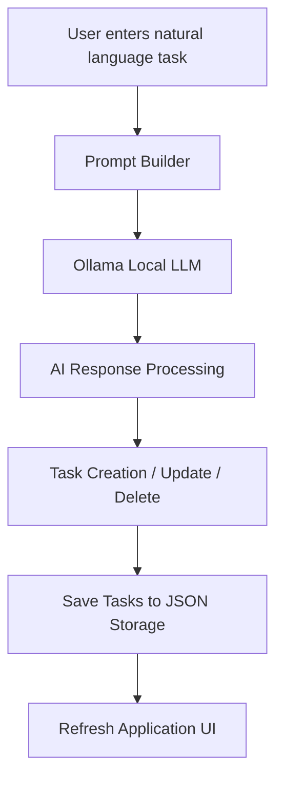

# Dodo 🦤

An AI-powered desktop to-do list application that allows users to manage tasks using natural language.

## What is Dodo?

Dodo is a smart to-do list application built with Python that combines traditional task management with local AI capabilities.

Instead of manually interacting with buttons and forms, users can communicate with Dodo using natural language. The application uses a locally running LLM through Ollama to understand user instructions and convert them into structured tasks.

For example, instead of creating a task manually:

> Add a task called "I gotta buy some shoes tomorrow"

Dodo can understand the request, extract the relevant information, create the task, and update the task list automatically.

The goal of Dodo is to explore how AI can improve everyday productivity tools by making interactions more natural and intuitive.

## Features

- 🧠 Natural language task creation using a local LLM
- 🤖 Ollama integration for AI-powered task processing
- ✅ Create, update, and manage tasks through simple instructions
- 💾 Local data persistence
- ⚡ Background AI processing to keep the application responsive
- 🔒 Runs locally without requiring external AI APIs

## Motivation & Development Process

This is my first Python project and it started as a personal learning experiment. The goal was not only to create a functional to-do application, but also to understand the engineering logic behind building an AI-powered application from the ground up.

At the beginning of the project, my main focus was understanding the complete flow of a real application: how user input is captured, how natural language instructions can be interpreted by an LLM, how the model communicates with the application, how responses are processed, and how data is stored and updated.

Instead of treating AI integration as simply sending a request to a model, I wanted to understand the complete pipeline:

Building this project allowed me to explore several important concepts, including:

- Application architecture
- Event-driven programming
- Threading and background processing
- Local LLM integration
- Prompt engineering
- Data storage and management
- Separation between application logic and user interface

### AI-Assisted Development

During development, I used Claude Code as an AI programming assistant to help with refactoring, debugging, code organization, and improving the overall structure of the project.

The purpose of using AI assistance was not simply to generate code. Instead I used it as a learning tool to better understand programming concepts, architectural decisions, and software development practices.

By reviewing suggestions, asking questions, experimenting with different approaches, and understanding the reasoning behind changes, I was able to learn how the different components of the application work together.

Towards the end of development, Claude Code helped clean up and finalize parts of the codebase, improving readability, structure, and maintainability while keeping the original goals of the project.

### UI Development

The user interface was also developed with AI assistance. Since my current focus is primarily on Python, AI engineering, and application logic rather than UI/UX design, I decided to use AI tools to help create and refine the interface.

This allowed me to focus more deeply on the core engineering challenges: integrating an LLM, handling application logic, managing data flow, and creating a reliable workflow between the user and the AI system.

### What This Project Represents

This project represents my first step into building practical AI applications.

More than just the final application, the main goal was understanding the process behind creating a complete AI-powered system:

**Idea → Architecture → Implementation → Debugging → Refinement → Deployment**

It reflects my current approach to software development: using modern AI tools effectively while making sure I understand the concepts, logic, and engineering decisions behind the code.
